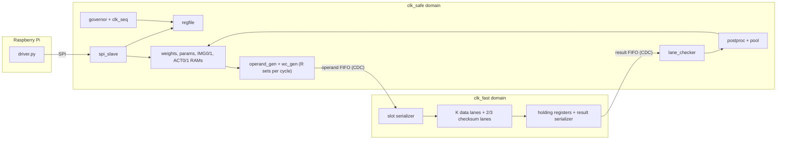

# SENTINEL architecture

Status: pre-board. Nothing here has been measured on hardware. The specification is
`docs/SPEC.md`; this document explains how the RTL realises it. Sizes and cycle counts are in
`docs/RESULTS_SIM.md`, generated from the result files.

## Block diagram

`clk_fast` is a glitch-free mux of `clk_safe` and the turbo clock, driven by the engine between
layers only (SPEC 7.7, checked by protocol monitors in `tb/tb_system.v`).

## Modules

| Module | Domain | Role |
| --- | --- | --- |
| `rtl/operand_gen.v` | safe | Walks the loops of SPEC 5.3, reads activations and weights, handles padding |
| `rtl/wc_gen.v`, `rtl/sum_tree.v` | safe | Checksum weights on the fly (ADR-002) |
| `rtl/cdc_fifo.v` | both | FWFT asynchronous FIFO; XPM on Vivado, Gray-code model in simulation |
| `rtl/fast_path.v` | fast | Slot serializer, STARVE counter, lane array |
| `rtl/lane_array.v`, `rtl/lane_*.v` | fast | MAC lanes, holding registers, serializer, injection |
| `rtl/lane_checker.v` | safe | d1/d2/d3, j search, correction (SPEC 6.2, ADR-008, ADR-009) |
| `rtl/postproc.v`, `rtl/pool.v` | safe | Requantisation and max pooling |
| `rtl/engine.v` | safe | Layer table, passes, recompute log, counters |
| `rtl/spi_slave.v`, `rtl/regfile.v` | safe | Host interface; `spec/regmap.yaml` is the single source |
| `rtl/governor.v`, `rtl/clk_seq.v` | safe | SPEC 10 policy and MMCM2 reconfiguration order (SPEC 7.7) |
| `rtl/top_core.v`, `board/top_board.v` | both | Integration, without and with board pins |

## Data flow for one layer

1. The engine loads the layer record from the parameter RAM (`model/export.py` defines the layout).
2. The generator walks groups, pool windows, the four positions and the T operand steps,
   issuing up to R operand sets per cycle. Unit bookkeeping goes to a small FIFO, whose depth is
   the credit limit; this keeps the result FIFO from overflowing without any fast-side backpressure.
3. Lanes accumulate; at the unit boundary the holding registers capture and the serializer
   emits S1, S2, (S3), YK..Y1.
4. The checker decides. Results go through requantisation and pooling and are written to the
   activation buffer. Failing windows are logged.
5. After the pass, logged windows are recomputed at the safe clock (SPEC 9).

## What is covered

The checksum protects MAC computation only. Errors in the broadcast activation after it leaves
the safe domain are not detected (SPEC 6.5). Multi-lane errors can be miscorrected without C3;
rates are in `docs/RESULTS_SIM.md`.
